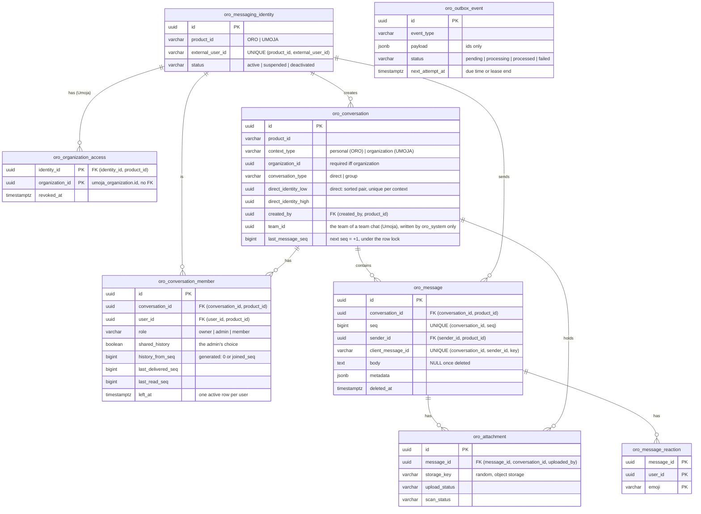

# Oro backend

The backend of Oro Messaging, the messaging service shared by **Oro** (personal messaging: direct
messages, friends, family groups, communities) and **Umoja** (business messaging inside an organization). The two
products keep their own accounts and authentication. They share this infrastructure, and nothing in it lets one
product reach the other's identities or conversations.

Spring Boot 4.1 / Java 25, Spring Data JPA (Hibernate 7), PostgreSQL 17. The schema is plain SQL in the shared database
repository, like the rest of Asata. There is no Flyway: `ddl-auto: none`.

| What | Where |
|---|---|
| Schema (tables, triggers, roles, RLS) | [`../../1_ASATA_DATABASE/CREATE_ORO_TABLES.sql`](../../1_ASATA_DATABASE/CREATE_ORO_TABLES.sql) |
| Development data and login | [`../../1_ASATA_DATABASE/oro/INSERT.sql`](../../1_ASATA_DATABASE/oro/INSERT.sql) |
| Drop | [`../../1_ASATA_DATABASE/oro/DROP.sql`](../../1_ASATA_DATABASE/oro/DROP.sql) |
| Entities, repositories, services | `src/main/java/com/asata/org/oro/{identity,conversation,message,attachment,outbox}` |
| REST API (interfaces `*Api`, controllers) | `src/main/java/com/asata/org/oro/{mainservice,identity,conversation,message,attachment,live}/api` |
| Live streams and presence | `src/main/java/com/asata/org/oro/live` |
| File storage | `src/main/java/com/asata/org/oro/attachment/storage` |
| Security, errors, actor resolution | `src/main/java/com/asata/org/oro/config/{security,web}` |
| Database context (role, RLS settings) | `src/main/java/com/asata/org/oro/context/DbSession.java` |
| Integration tests (Testcontainers) | `src/test/java/com/asata/org/oro` |

## Run

### Database

A new database: the scripts run on the first start of the shared database (`06-oro-create`, `07-oro-insert`).

```bash
cd ../../1_ASATA_DATABASE
docker compose up -d            # or: docker compose down -v && docker compose up -d to recreate it
```

An existing database: both scripts can be run again; they only add what is missing.

```bash
cd ../../1_ASATA_DATABASE
docker exec -i asata-postgres-1 sh -c 'psql -v ON_ERROR_STOP=1 -U "$POSTGRES_USER" -d asata' < CREATE_ORO_TABLES.sql
docker exec -i asata-postgres-1 sh -c 'psql -v ON_ERROR_STOP=1 -U "$POSTGRES_USER" -d asata' < oro/INSERT.sql   # development only
```

`oro/INSERT.sql` creates the two development logins, with placeholder passwords: `oro_api` (`oro_api_dev`) for the
API and `oro_worker` (`oro_worker_dev`) for the integrations and workers. A deployment creates its own logins, with
secrets from its vault, and never runs the seed.

### Backend with Docker

```bash
docker compose -f ../../1_ASATA_DATABASE/docker-compose.yml up -d    # the shared database, once
cd .. && docker compose up --build                                   # reads backend/.env.local
```

API: http://localhost:8082/oro, Swagger UI: http://localhost:8082/oro/doc (on in this compose file only). The port is
published on `127.0.0.1` only. The container joins the shared database on the Docker network `asataDB`
(`asata-postgres:5432`) with its two logins. Settings go in `backend/.env.local`, which git ignores:

| Variable | Default | Purpose |
|---|---|---|
| `UMOJA_JWKS_URI` | `http://umoja:8080/umoja/.well-known/jwks.json` (`http://localhost:8081/…` outside Docker) | Where Umoja publishes the public keys of its tokens. Empty: Umoja users cannot call Oro |
| `ORO_JWKS_URI` | none | Empty: Oro's tokens are the ones its accounts sign, checked with their keys in the process. Set: another issuer of Oro's tokens |
| `ORO_ACCOUNTS_SIGNING_KEY` | a new one at each start | The RSA key that signs the access tokens of Oro's accounts (PKCS#8, base64); required in production (a secret file) |
| `ORO_ACCOUNT_DATASOURCE_USERNAME`, `_PASSWORD` | `oro_auth` | The accounts' login (`oro_account` only): the only one that reads a password |
| `ORO_COOKIE_SECURE` | `true` | The refresh cookie only over HTTPS (`false` for `http://localhost`) |
| `UMOJA_INTEGRATION_KEYS`, `ORO_INTEGRATION_KEYS` | none | The keys of the trusted integrations (`/internal`) as `name:sha256`, comma separated: the SHA-256 of each key in hex, never the key (`printf %s "$KEY" \| shasum -a 256`); two during a [rotation](#rotating-an-integration-key). A key has 32 characters at least (`openssl rand -hex 32`) |
| `ORO_PORT` | `8082` | Port on the host (8080 Mokili, 8081 Umoja) |
| `ORO_DB_USERNAME`, `ORO_DB_PASSWORD` | `oro_api`, `oro_api_dev` | The API's login (`NOINHERIT`, a member of `oro_app` only, never a superuser) and its password |
| `ORO_WORKER_DB_USERNAME`, `ORO_WORKER_DB_PASSWORD` | `oro_worker`, `oro_worker_dev` | The worker's login (`NOINHERIT`, a member of `oro_system` only) and its password |
| `ORO_API_DOCS` | `true` here, `false` in `application.yml` | Swagger UI and the OpenAPI description; off in production |
| `ORO_OUTBOX_ENABLED` | `true` | Runs the outbox worker |
| `ORO_STORAGE_PROVIDER` | `local` | Where the files of the attachments go: `local` (a disk, `ORO_ATTACHMENTS_DIR`); another provider needs its `FileStorage`, until then nothing can be uploaded |
| `ORO_ATTACHMENTS_DIR` | `./data/attachments` (`/data/attachments` in Docker, a volume) | The directory of the local storage |
| `ORO_ATTACHMENTS_SCAN` | `clamav` here, `none` in `application.yml` | `clamav`: every file scanned by clamd before it can be downloaded, fail closed; `none`: no scanner, a file is recorded clean unscanned (**development only**) |
| `ORO_CLAMAV_HOST`, `ORO_CLAMAV_PORT` | `clamav`, `3310` | clamd (the `clamav` service of the compose file) |
| `ORO_ATTACHMENTS_PURGE` | `true` | The purge of the files Oro no longer keeps |
| `ORO_ATTACHMENTS_QUOTA_BYTES`, `ORO_ATTACHMENTS_QUOTA_FILES_PER_DAY` | `1073741824` (1 GiB), `200` | What a user may upload: the bytes of its files not deleted, its files of the last 24 hours (413, 429 beyond) |
| `ORO_ATTACHMENTS_MIN_FREE_BYTES` | `1073741824` | The local storage keeps this much of its disk free (503 beyond) |
| `ORO_MULTIPART_DIR` | the server's temporary directory (`/data/attachments/.incoming` in Docker) | Where an upload is received before it is stored: the data volume, not the disk of the system |
| `ORO_FILES_BACKUP_PASSWORD` | none | The passphrase of the backups of the files (restic); unset: no backup. Lost, the backups are lost with it |
| `ORO_FILES_BACKUP_REPOSITORY`, `ORO_FILES_BACKUP_S3_KEY`, `ORO_FILES_BACKUP_S3_SECRET` | a volume | Where the backups of the files go: `s3:<endpoint>/<bucket>/oro-files` and its keys in production |
| `SPRING_PROFILES_ACTIVE` | none | `production`: the secrets from `/run/secrets` (one file per setting), and a refusal to start on any setting of development (`ProductionChecks`); see `docs/deployment.md` |
| `ORO_DB_POOL_SIZE`, `ORO_WORKER_DB_POOL_SIZE` | `10`, `5` | The connections of the API and of the worker. More does not help once the CPUs are busy ([load test](perf/README.md#load-test-2026-10-24)); keep the sum of every service under PostgreSQL's `max_connections` (100) |
| `ORO_MANAGEMENT_PORT` | `9082` | The actuator (health, `/actuator/prometheus`), never published: Prometheus reads it on the private network |
| `ORO_LOG_FORMAT` | `ecs` here | The logs as JSON (Elastic Common Schema), the request id in each line; unset outside Docker: plain lines |
| `ORO_RATE_LIMITS` | `true` | The [rate limits](#rate-limits) of the users; `false` only to measure without them |
| `ORO_CORS_ALLOWED_ORIGINS` | `http://localhost:4200,http://localhost:4201` | Browser origins allowed to call the API |

### Backend locally

```bash
SPRING_DATASOURCE_PASSWORD=oro_api_dev ORO_SYSTEM_DATASOURCE_PASSWORD=oro_worker_dev ORO_API_DOCS=true \
  ./mvnw spring-boot:run    # localhost:5433/asata, port 8082; Umoja's keys from localhost:8081
```

The schema changes of an existing database go through `../../1_ASATA_DATABASE/oro/migrate.sh` (numbered migrations,
recorded in `oro_schema_version`; `oro/migrations/README.md`). Never connect as a superuser: superusers bypass RLS. Local settings go in `src/main/resources/application-local.yml`,
which git ignores.

### Tests

```bash
./mvnw test        # Docker must be running
```

The tests start a PostgreSQL 17 container built by the real `CREATE_ORO_TABLES.sql`. The backend connects to it the
way it does in production: as a `NOINHERIT` login that takes `oro_app` or `oro_system` in each transaction. The scripts
are read from `../../1_ASATA_DATABASE`; override the location with `-Dasata.database.dir=...`. H2 is not used: it has
no RLS, no PL/pgSQL triggers and no `SKIP LOCKED`, and those are what the tests check.

| Test class | What it proves |
|---|---|
| `SchemaScriptTest` | The script runs again on an existing database; RLS is on every table, owned by `oro_owner`; `oro_app` cannot bypass RLS or read the organization accesses or the outbox; the API's login is a member of `oro_app` only, the worker's of `oro_system` only; the seed loads both products and every context, and runs twice without duplicates |
| `ProductIsolationTest` | The same external user ID in both products gives two identities; an Oro identity cannot join a Umoja conversation, and the reverse; no creator or direct pair from another product; an invalid organization context is rejected; organization members need an organization access |
| `ConversationAccessTest` | Non-members and other organizations read nothing, through the services and through raw SQL; leaving, removal, revoked access and deactivation end access; members cannot rejoin on their own; the admin's choice of history is applied; concurrent creation of the same direct conversation gives one; one direct conversation per pair and organization; unread counts; the roles hold in the database (raw SQL as a plain member or an admin); system messages tell only what happened, as who did it |
| `MessageTest` | Idempotency, including concurrent retries; consecutive sequence numbers without gaps under concurrency; a failed transaction leaves neither the message nor its event, and no gap; no sending as someone else (RLS); sequence integrity; cursor pagination; deleted content is erased for good; edits |
| `RlsContextTest` | No context means no right at all; the context never leaks to the next transaction on a pooled connection (after a commit or a rollback); product-only context; the context can only be set inside a transaction; the API's login never takes `oro_system`, and each context only on its own login; slow statements and long lock waits end |
| `CatchUpTest` | Over HTTP: a stream cut, two messages sent meanwhile, the stream back; the list and `?after=` give what was missed |
| `AccountTest` | Sign-in by email or username, the token on the API, one answer for every failure, the lock after 5 wrong passwords, rotation and a stolen session, sign-out, Umoja's tokens refused, the logins apart |
| `OutboxTest` | Publishing; concurrent workers never claim the same event; backoff, then `failed`, with no exception message stored; expired leases are taken over and the stale worker cannot complete; retention; `ops/outbox-replay.sh` (list, by id, all; anything but an id refused) |
| `ApiTest` | The HTTP chain with tokens really signed by each product (RS256, `TestTokens`): another key (even under a published `kid`), the audience, HS256 with the former shared secret, unsigned tokens, unknown issuer, expiry, no expiry, a subject that is not an account id, not-before, clock skew; no API description by default; the organization header against the accesses; integration keys per product; an end-to-end Oro conversation; validation; members and history; deactivation |
| `MessagingFeaturesTest` | The team chats follow their team (name, members, system messages; nothing written when nothing changed); the users cannot change them nor make one; leaving the organization ends the conversations; a late snapshot never brings back a revoked access, and concurrent synchronizations end as the newest; the list (last message, the other one, unread); mute; rename; reactions (one emoji, RLS, gone with a deleted message); search (only what the member may read, wildcards as text); read times; the live events of the outbox and of typing |
| `MessagingApiTest` | The same over HTTP: the synchronization by the Umoja integration only; list, reactions, search, mute, read positions, typing; a file uploaded (its name cleaned, its size limited), sent, then downloaded by the members only with safe headers |
| `EmojisTest` | A reaction is one emoji whatever it is (skin tones, flags, ZWJ sequences); never text, digits, keycaps, a lone modifier nor several emojis |
| `LiveHubTest` | Five streams per user, the sixth refused and none closed for it; a cap per instance; the streams and the presence: online while a stream is open, per organization; an event reaches its recipients in its scope only; a stream ends with its token (30 minutes at most) with `reconnect`; closed by identity or organization, offline after |
| `LiveAuthorizationTest` | Revocation, suspension and deactivation close the streams with their commit; the periodic check closes what changed elsewhere; a stream lasts as long as its token |
| `IntegrationKeyTest` | During a rotation both keys open `/internal`; the logs name the key used, never the key; a key not listed, a short one or the stored hash itself is refused |
| `IntegrationKeysConfigTest` | The keys are configured as `name:sha256` only: the key itself, a name twice or a key for two products is refused |
| `StorageQuotaTest` | The bytes of a user are bounded (413) and given back by a deletion; the files of a day are bounded (429), deleted or not; nothing is stored when refused |
| `LocalFileStorageSpaceTest` | An upload that would eat into the free space kept on the disk is refused (503) |
| `AttachmentPurgeTest` | The files of deleted messages, the uploads never attached and never received go, file and row; the others stay; the files without an attachment go after a day, never the ones being received |
| `ImageMetadataTest` | JPEG, PNG and WebP lose their Exif, XMP, texts and comments, keep their pixels and the JPEG orientation; a file that is not the image it says is refused |
| `FileTypesTest`, `FileUploadTest` | The type comes from the bytes: a page declared as an image is downloaded, never shown; a photo is stored without its metadata; a broken image is refused |
| `MalwareScanTest` | Against a clamd of the test: clean files downloadable, EICAR refused and deleted, nothing downloadable while clamd is away then scanned, a file clamd cannot read never downloadable |
| `MetricsTest` | Prometheus reads Oro without a token: the gauges follow the database (the outbox), the sends are timed, the lock waits and the refused requests counted |
| `MigrationTest` | The runner of the schema: a new database, migrations applied once in the order of their numbers and recorded, an applied one changed or a failing one stops it and leaves nothing, the migrations of before recorded as included in a new database |
| `ProductionChecksTest` | Production refuses the settings of development, all at once, naming them without their values |
| `HttpExceptionHandlerTest` | No database connection free in time: 503 and `Retry-After`, not 500 |
| `RequestSizeTest` | A request that is not an upload carries 1 MiB at most, with a length or without |
| `RateLimiterTest` | A bucket: the burst, then the rate, the wait until the next request; never more than the burst; the idle buckets go |
| `RateLimitTest` | Over HTTP: 429 with `Retry-After` and nothing created; the other kinds and the other users are not limited by it; every request counts in `any` |
| `JwkSetUriTest` | The public keys are read from where the product publishes them, at the first token then for a new `kid`: a rotation needs no restart; an unpublished key is refused |
| `LogPrivacyTest` | A message refused by the database leaves its constraint in the logs, never its text nor the refused row |
| `AttachmentTest` | Metadata is visible only to those who can read the message, even with the storage key; downloads need an uploaded and clean file; the API cannot mark a file clean; a sender can attach only their own uploads; a deleted message's files are hidden and marked for purge; file names cannot be paths |

## API

All routes are under `/oro`. Errors are JSON (`status`, `message`, `requestId`; never a database detail). Every response
carries an `x-request-id` header.

### Who may call

- **Users** send `Authorization: Bearer <access token of their product>`. Each product signs its own tokens (RS256)
  with its own private key, under its own issuer (`oro`, `umoja`), for the audience `oro` among others. Oro reads the
  issuer and checks the signature with the public keys that product publishes (a JWK set: Umoja's
  `/umoja/.well-known/jwks.json`, read at the first token and again for an unknown `kid`, so a rotation needs no
  restart). Oro holds nothing that could sign a token, and a token from one product is never accepted as the other's.
  Another algorithm (HS256, none), a key that product did not publish, a token without `oro` in its audience, an
  unknown issuer, a bad signature, no expiry,
  an expiry past by more than 30 s, a not-before not reached yet, or a subject that is not an account id
  (`[A-Za-z0-9._:-]{1,128}`, never an email) gets 401.
  - The subject is the account's ID in its product (for Umoja, `asata_user.id`). Its messaging identity is created on
    its first request: a valid product token proves the account exists.
  - Suspended or deactivated identities get 403.
- **Umoja requests** name their organization in `x-organization-id`. Umoja tokens carry no organization, so the header
  only picks one of the user's current accesses (fed by Umoja); it never grants one. A missing header gets 400, an
  organization without access gets 403. Oro requests must not send the header.
- **Trusted integrations** call `/internal` with `x-integration-key`. A key acts for its own product only, and user
  tokens are refused there. Oro keeps only the SHA-256 of each key, named: the logs say which key authenticated
  (`integration UMOJA authenticated with its key current`), and a refused key is logged without it. `/internal` is for the private network only: a product's proxy never forwards it (Umoja's
  nginx answers 404).
- Clients name other users by their **user ID in their product** (`userId`), never by Oro's internal IDs.
- Anything outside the caller's reach answers 404, never 403, so an ID reveals nothing.

### Routes

| Route | What |
|---|---|
| `GET /ping` | Status, public |
| `GET /actuator/health/liveness`, `/readiness` | On the management port (9082) only, never published: the health check of the container |
| `GET /doc`, `GET /doc/api` | Swagger UI, OpenAPI (only with `ORO_API_DOCS=true`) |
| `GET /me` | The caller: identity, product, user ID, organization |
| `GET /conversations` | The caller's active conversations in its context, latest first, with unread counts |
| `POST /conversations/direct` `{userId}` | The direct conversation with a user (created the first time; concurrent calls give one) |
| `POST /conversations/groups` `{name, description, memberUserIds}` | A group, with the caller as owner |
| `GET /conversations/{id}` | A conversation and its active members |
| `POST /conversations/{id}/members` `{userId, shareHistory}` | Owner or admin adds a member, choosing whether it sees the history |
| `DELETE /conversations/{id}/members/{userId}` | Removes a member (owner or admin), or leaves (the caller's own user ID) |
| `PUT /conversations/{id}/read`, `/delivered` `{seq}` | The caller's positions (only move forward) |
| `GET /conversations/{id}/messages?before=&size=` | Newest first, then `before=nextBeforeSeq`; `?after=seq` catches up, oldest first |
| `POST /conversations/{id}/messages` `{clientMessageId, type, body, metadata, attachmentIds}` | 201 stored; 200 when a retry with the same `clientMessageId` returns the stored message |
| `PUT /messages/{id}` `{body}`, `DELETE /messages/{id}` | The sender edits, or deletes (the content is erased) |
| `GET /messages/{id}` | A message the caller may read (after a change on its stream) |
| `PUT`, `DELETE /messages/{id}/reactions/{emoji}` | Gives or takes back a reaction: one emoji, any (skin tones, flags and ZWJ sequences included), once per emoji |
| `GET /search/messages?q=&conversationId=` | The messages the caller may read containing the text, newest first (30 at most) |
| `PUT /conversations/{id}` `{name, description}` | Owner or admin renames a group (not a team chat) |
| `PUT /conversations/{id}/mute` `{until}` | Mutes for the caller, `null` unmutes |
| `POST /conversations/{id}/typing` | The other members see it on their streams; nothing is stored |
| `POST /conversations/{id}/attachments` (multipart `file`) | Uploads a file, then send a message with its id |
| `GET /attachments/{id}/content` | Downloads a file of a message the caller may read |
| `GET /stream` | The stream of the caller (Server-Sent Events), see [Live](#live-the-stream-of-each-user) |
| `GET /presence` | Who is online in the caller's context |
| `PUT /internal/identities/{userId}` | Integration: provisions an identity |
| `POST /internal/identities/{userId}/suspend`, `/reactivate`, `/deactivate` | Integration: changes an identity's status |
| `PUT`, `DELETE /internal/organizations/{organizationId}/members/{userId}` | Umoja integration: grants or revokes an organization access |
| `PUT /internal/organizations/{organizationId}` `{version, memberUserIds, teams: [{teamId, name, memberUserIds}]}` | Umoja integration: the organization as it is now (see [Team chats](#team-chats-and-the-umoja-synchronization)) |

```bash
# Umoja: Jordan's conversations in Acme (a token from the Umoja backend's login)
curl -H "Authorization: Bearer $TOKEN" -H "x-organization-id: <organization id>" http://localhost:8082/oro/conversations
# Umoja's integration: Amara joins Acme's conversations
curl -X PUT -H "x-integration-key: $UMOJA_INTEGRATION_KEY" http://localhost:8082/oro/internal/organizations/<org>/members/<asata user id>   # the key, as Umoja has it
```

## Accounts

Oro's people sign in with their **Asata account**: the users of `asata_user` and their password
(`asata_user_credential`), shared with Umoja and Mokili (the same account, the same password, the same lock after 5
wrong passwords). Oro signs their access tokens itself (`account/`):

| Route | What |
|---|---|
| `POST /auth/login` `{login, password, remember}` | The email or the username and the password: an access token (15 min) in the body, the refresh token in a cookie |
| `POST /auth/refresh` | A new access token from the cookie, which is replaced |
| `POST /auth/logout` | The session closed, the cookie cleared |
| `GET /.well-known/jwks.json` | The public keys of Oro's tokens |

- **Tokens**: RS256 with Oro's key (`ORO_ACCOUNTS_SIGNING_KEY`, its kid), issuer `oro`, audience `oro`, the Asata
  account's id as subject, the session in `sid`. Oro checks them as the tokens of the product ORO, with its own public
  keys, in the process: the account id is the identity's external id.
- **Sessions**: the refresh token in an HttpOnly cookie, `SameSite=Strict`, for `/oro/auth` only, Secure in
  production; 12 hours, or 30 days with `remember`. Stored in `asata_user_refresh_token`, issuer `oro`, as the
  SHA-256 of `oro:` + the token: Umoja and Mokili look tokens up by the SHA-256 of the token alone, so they never find
  Oro's, nor Oro theirs. Replaced at each use; a replaced token used again (stolen) ends the whole session.
- **Failures**: the same answer for an unknown login, a wrong password, a locked or a disabled account, in the same
  time (a dummy hash). The logs name the account by its id, never the login typed.
- **Logins**: the accounts work through their own database login, `oro_auth`, which can take `oro_account` only:
  some columns of `asata_user`, `asata_user_credential` and `asata_user_refresh_token`, nothing of the messaging. The
  logins of the messaging never read a password (`AccountTest`).
- **Not yet**: signing up, verifying an email, recovering a password, rate limits per address on these routes, phone
  accounts.

## Rate limits

Each user (the issuer and subject of its token) has buckets per kind of request, in the memory of the instance
(`RateLimitInterceptor`, `oro.rate-limits`): a burst at once, then a rate a minute. Every request takes from `any`, and
the costly or noisy ones from their own bucket too. Over a limit: 429 with `Retry-After`, before any work of the request
(no database, nothing stored).

| Kind | Requests | A minute | Burst |
|---|---|---|---|
| `any` | every request of a user | 300 | 100 |
| `send` | `POST /conversations/{id}/messages` | 60 | 20 |
| `change-message` | `PUT`, `DELETE /messages/{id}` | 30 | 10 |
| `react` | `PUT`, `DELETE /messages/{id}/reactions/{emoji}` | 60 | 20 |
| `typing` | `POST /conversations/{id}/typing` | 30 | 5 |
| `search` | `GET /search/messages` | 20 | 5 |
| `open-direct` | `POST /conversations/direct` | 20 | 10 |
| `create-group` | `POST /conversations/groups` | 3 | 5 |
| `add-member` | `POST /conversations/{id}/members` | 30 | 20 |
| `upload` | `POST /conversations/{id}/attachments` | 10 | 5 |
| `stream` | `GET /stream` | 10 | 5 |

Open streams are bounded too: 5 per user (its tabs and devices), 10,000 per instance (`oro.live.max-streams-*`). The
next one is refused, 429 for the user and 503 for the instance, and no open stream is closed for it: a closed one would
reconnect and close another. The refused tab keeps up by polling.

Uploads have a quota per user, checked before anything is received into the storage (`AttachmentQuota`, as
`oro_system`: the conversations it left count too): 1 GiB of files not deleted (413 beyond) and 200 files in 24 hours,
deleted or not (429 beyond). The local storage keeps 1 GiB of its disk free (503 beyond, logged as an error). An upload
is received on the data volume (`ORO_MULTIPART_DIR`) and its temporary file deleted after the request.

The integrations (`/internal`) are trusted and not limited. In front, the proxy of a product limits each address
(Umoja's nginx: 50 a second, bursts of 200, generous because an office behind one address is many users). With several
instances, each counts apart: the limits move to a shared counter then.

## Team chats and the Umoja synchronization

Umoja tells Oro, with the key of its integration, who is in each of its organizations:
`PUT /internal/organizations/{id}` with all the members and all the teams (their members, the lead first). In one
transaction (`OrganizationSyncService`):

- each member gets an organization access (granted again if it was revoked); the others lose theirs, so they leave the
  conversations of the organization (trigger);
- each team has one group, its **team chat** (`team_id`, unique per organization), named after it, whose members are the
  team's and read its whole history. A member who joins or leaves it is told by a system message (not the founders);
- the chat of a team that is gone keeps its history and loses its members.

Only `oro_system` may write `team_id` (oro_app has a column-level INSERT grant without it), and the API and the
database refuse to add, remove, rename or leave a team chat: the team decides. The synchronization is idempotent: Umoja
sends it after every change of its memberships and teams, when a user opens the messages, and every 10 minutes.

Each snapshot carries a `version`: when Umoja read it (microseconds since the epoch), Umoja reading and sending one
organization at a time. Oro updates the organization's row in `oro_organization_sync` first, so the synchronizations of
one organization run one after the other, and a snapshot older than the last one applied changes nothing (`applied:
false`). A snapshot read before a revocation and arriving after it never gives the access back.

## Live: the stream of each user

`GET /stream` keeps a Server-Sent Events stream open as long as the token that opened it (30 minutes at most), then
sends `reconnect` and ends: the client opens another with a new token. A comment every 25 s keeps the proxies from
closing it. The browser reads it with `fetch`, so that it carries the token. Its events are
ids and numbers only; the client reads what changed through the API:

| Event | When |
|---|---|
| `hello {online}` | At the start: who is online in the caller's context |
| `presence {userId, online}` | Someone of the context opened their first stream, or closed their last one |
| `message {change: created, edited, deleted, reaction; conversationId, messageId, seq}` | From the outbox (about 1 s) |
| `conversation {change; conversationId}` | Created, renamed, a member added or gone (the one who left hears it too) |
| `typing {conversationId, userId}` | At once, for the other members; lasts a few seconds |
| `read {conversationId, userId, seq}` | At once, for the members ("Seen") |
| `reconnect` | Open a new stream: the token expired (with a new token), Oro is stopping, or an event was too old to send |

A stream is as good as a new request (`LiveAuthorization`): it is closed with the commit that suspends or deactivates
its identity or revokes its organization access, and a check every 30 s closes any stream whose identity is no longer
active or whose access is no longer current, whatever changed them. Its user is then offline for the others.

The streams and the presence live in the memory of the instance (`LiveHub`): several instances need a shared bus
(PostgreSQL `LISTEN/NOTIFY`, Redis) for the events and the presence.

### Catching up

The stream says what changed; it never replays what a client missed. A stream ends often (its token, a restart of
Oro, a network that drops, a client 500 events behind, an event too old to send), and the events of the gap are lost
to it. So a client, on **every** `hello` (the first one too):

1. reads the list again (`GET /conversations`): unread counts and last messages of every conversation;
2. for the conversation open on its screen, reads what came after the last message it has
   (`GET /conversations/{id}/messages?after=<its last seq>`), and the newest page again (`GET
   /conversations/{id}/messages`), for what was edited, deleted or reacted to meanwhile;
3. reads that conversation again (`GET /conversations/{id}`): its members and their read positions.

Until a stream is open, the client reads the list every so often instead. Between two `hello`, the events are
enough. A client that follows this misses nothing, without ids of events or a replay: `CatchUpTest` checks it over
HTTP (a stream cut, two messages sent, the stream back), and Umoja's client does it (`MessagingStore`, `ChatPanel`).
What is older than the newest page and changed during a gap shows on the next load of the conversation.

## Schema



### Identities

Each product account maps to one `oro_messaging_identity`, unique on `(product_id, external_user_id)`. For Oro the
external ID is its account ID; for Umoja it is `asata_user.id`. The table holds no email, phone, username or
credential, and identities from different products are never linked: the same external ID in both products is two
identities. External IDs cannot contain `@`, so an email cannot be used as one.

Provisioning (`IdentityService.provision`) and status changes are for the products' trusted integrations only (role
`oro_system`). Provisioning is idempotent: `INSERT … ON CONFLICT DO NOTHING`, then a read. A suspended identity keeps
its memberships but reads and sends nothing. A deactivated identity is final: it leaves all its conversations and
loses its organization accesses, in the same transaction (trigger).

### Product isolation and context

Every table carries `product_id`, and every reference is a composite foreign key `(x_id, product_id)` →
`(id, product_id)`. This covers creators, direct pairs, members, senders and attachments, so a row cannot mix
products whatever the code does.

`ck_oro_conversation_context` allows exactly two combinations:
- Oro → `personal`, no organization
- Umoja → `organization`, with `organization_id`

Opening other combinations later means relaxing this one constraint. Members and messages do not repeat the
organization; they inherit it from their conversation, so they cannot disagree with it.

### Umoja organization authorization

The organization memberships belong to Umoja. Oro never reads Umoja's database, and no foreign key can check data owned
by another system. Instead:

1. **`oro_organization_access`** is Oro's copy of who may take part in an organization's conversations. Only
   `oro_system` writes it, fed by the Umoja integration: a push on each change (grant, revoke), plus a periodic
   reconciliation that compares the full list.
2. **Triggers** require a current access for the creator of an organization conversation and for each new member.
   Revoking (or deleting) an access ends that identity's memberships in the organization's conversations, in the same
   transaction.
3. **On each request**, the API reads the organization from the `x-organization-id` header (Umoja tokens carry none)
   and accepts it only if the identity has a current access to it (403 otherwise). Then it builds
   `Actor.umoja(identity, organization)` (`ActorResolver`). `ConversationAccess` refuses any conversation outside that
   organization with `NotFound`, the same answer as for one that doesn't exist.

The access list is only as fresh as the feed. An access revoked in Umoja keeps working in Oro until the push arrives (or
the next reconciliation runs), so the push should happen in the same operation that removes the membership in Umoja. A
short-lived organization claim in the Umoja tokens would close that window.

### Direct conversations

A direct conversation stores its pair sorted by PostgreSQL (`direct_identity_low < direct_identity_high`, compared as
`uuid`; `java.util.UUID` orders differently, so the API sorts with `LEAST`/`GREATEST` in SQL). Two partial unique
indexes, one for personal and one per organization, make the pair one conversation per context. Personal and
organization conversations between the same people stay separate.

`ConversationService.openDirect` runs `INSERT … ON CONFLICT DO NOTHING`, then reads the row, then adds both
memberships (`ON CONFLICT DO NOTHING` on the active-membership index). Concurrent calls, in either order, all wait on
the unique index for the first insert and then find its row. There is no read-then-insert race. Only the pair may
join, and a direct conversation cannot be left (only revocation or deactivation ends it).

### Memberships and history

A membership is one period, `joined_at` to `left_at`, recorded with a reason: `left`, `removed`, `access_revoked` or
`deactivated`. Rejoining adds a new row; the partial unique index allows one active row per user. An ended row never
changes again.

Access policy:
- Only an active member can read a conversation. Leaving or removal ends access to everything, history included.
- Ended members cannot add themselves back; an admin must re-add them.
- The admin who adds a member chooses `shared_history`:
  - true: the member reads the whole history
  - false (the default, privacy first): only messages after `joined_seq`
- `history_from_seq` is a generated column (`0` or `joined_seq`), so it can't be forged, and both RLS and the queries
  use it.
- The trigger sets `joined_seq` from the conversation while holding its row lock, so a member always joins between two
  messages, never during one.

### Messages, ordering and idempotency

Each conversation keeps `last_message_seq`. A send moves it forward by exactly one under the row lock (the trigger
refuses anything else), and the message takes that number (the trigger checks `seq <= last_message_seq`, and
`uq_oro_message_seq` stops reuse). This gives a strict order with no gaps, a stable cursor, and unread counts without
counting rows.

The price is that sends in one conversation run one at a time: a few milliseconds each. That limits a single
conversation to roughly a few hundred messages per second, far beyond normal chat. A huge broadcast channel would need a
different design (e.g. `(created_at, id)` ordering without the lock).

**Sending (`MessageService.send`) is one transaction:**
1. Authenticate (API) and set the context (`DbSession.enterUser`: role `oro_app` plus the RLS settings).
2. Lock the conversation (`SELECT … FOR NO KEY UPDATE`), within the actor's product and organization.
3. Check active membership (service, and again in the trigger).
4. Look up the idempotency key `(conversation_id, sender_id, client_message_id)`. A retry returns the stored message
   (`duplicate = true`). A concurrent retry waits on the lock and then finds it; the unique constraint backs this up.
5. Take the next `seq`, insert the message, attach the sender's uploads, and move the sender's read position.
6. Insert the outbox event `message.created`.
7. Commit. Any failure rolls everything back, including the sequence number, so no gap appears.
8. A worker publishes the event later, with retries.

A committed message is **stored**, not delivered. **Delivered** (`last_delivered_seq`) means a recipient's device
acknowledged it; **read** (`last_read_seq`) means the user saw it. Both positions only move forward and are clamped to
the last message by the trigger.

**Deletion** keeps the row as a tombstone so the message keeps its place in the order. The trigger erases the content
(`body` NULL, `metadata` `{}`), a check constraint guarantees it, and a deleted message cannot be undeleted or edited.
Its attachments are marked `deleted_at` for purging. Edits set `edited_at` (in the database); no edit history is kept.
`metadata` holds the mentions of a message and nothing else: `{"mentions": ["<user id>", ...]}`, at most 50, each an
active member of the conversation (`MessageMetadata`); any other key gets 400, so a sender cannot forge a link preview
or a system event that other clients would show. System messages carry what happened (`event`, `userId`), written by
Oro only. The database keeps the 8 KB limit.

### Read state: positions, not receipts

Each member stores a read position (`last_read_seq`) and a delivered position (`last_delivered_seq`). This is one
update per conversation read, instead of one row per message per recipient. Unread count =
`conversation.last_message_seq − member.last_read_seq`; `ConversationService.list` computes it for every conversation
in one query.

Switch to per-message receipts (a `message_receipt(message_id, user_id, delivered_at, read_at)` table, partitioned)
only if the product needs:
- read-by-whom lists in groups ("seen by 12"), or
- read state that is not in order (marking a single older message as read).

Even then, keep the positions for the counts.

### Reactions

A reaction is one emoji of a member on a message it can read, once per (message, member, emoji). The API accepts any
emoji as Unicode defines them (`Emojis`: its emoji properties, not a list): one grapheme, a pictograph or a flag, with
its skin tones and ZWJ sequences, 16 UTF-16 units at most. Text, digits, keycaps and several emojis are refused (400).
The database checks the length and refuses letters, digits, spaces and markup characters. Reactions are gone with
their message when it is deleted.

### Attachments

Files live outside the database; PostgreSQL holds only their metadata. The flow with an object storage (not written
yet, see the local storage below for what runs today):

1. **Register**: the API creates the row and returns a signed upload URL. The storage key is random and never built
   from the file name.
2. **Upload**: the client uploads directly to the storage.
3. **Check**: `oro_system` checks the real size and checksum (`markUploaded`), then records the malware scan
   (`recordScan`).
4. **Attach**: the sender attaches the file when sending. A composite foreign key ties it to a message of the same
   conversation and sender; a rejected or infected file cannot be attached.
5. **Download**: only an active member who can read the message, only an uploaded and clean file, through a
   short-lived signed URL.

`oro_app` may change only `message_id`, so the API can never mark a file clean, and the storage key gives access to
nothing.

**The local storage** (`ORO_STORAGE_PROVIDER=local`, `LocalFileStorage`) takes the upload through the API instead of a
signed URL: `POST /conversations/{id}/attachments` registers the file, writes it under its key (to a temporary name,
moved once complete), records its real size and SHA-256, then the scan. `GET /attachments/{id}/content` streams it to
the members who may read its message: images (PNG, JPEG, GIF, WebP) inline, everything else (SVG and HTML included) as a
download, with `X-Content-Type-Options: nosniff` and a sandboxing `Content-Security-Policy`. The file name is cleaned
(no path, no control character).

**The type of a file** comes from its bytes (`FileTypes`, Apache Tika's detection): a file is an image shown inline
only when its bytes are one, and a page or a script declared as an image is recorded as what it is and only ever
downloaded. The declared type is kept for what is downloaded only (a `.docx`, detected as a zip).

**Photos lose their metadata** before they are stored (`ImageMetadata`, without decoding them: same pixels, same
quality): JPEG Exif, XMP, IPTC and comments, PNG text and Exif chunks, WebP EXIF and XMP chunks. Where, when and with
what a photo was taken leave with them; the JPEG orientation is kept, alone, so that a photo of a phone is not shown
sideways. A file that is not the image its bytes say is refused (400).

**The malware scan** (`ORO_ATTACHMENTS_SCAN=clamav`, `AttachmentScanning`, ClamAV's clamd with INSTREAM) runs on each
file once stored, fail closed: a file is downloadable only once clamd said clean. Infected: the upload is refused (422),
its file deleted at once, its row kept infected (never attached). A file clamd cannot read (its size limit) is failed,
for good. While clamd is away, the files stay pending (the upload answers `available: false`) and are scanned again
every minute. Without a scanner (`ORO_ATTACHMENTS_SCAN=none`), a file is recorded clean unscanned: for development only.

**The purge** (`AttachmentPurge`, as `oro_system`, every 15 minutes): the files of deleted messages at once, the uploads
never attached after 24 hours, the uploads never received after an hour; file first, then row. Every day, the files of
the storage without an attachment, a day old. The quota of a user counts its abandoned uploads until then.

### Outbox

`oro_outbox_event` rows are written in the same transaction as their change: an event exists if and only if the change
was committed. Payloads hold only IDs, sequence numbers and codes (`OutboxWriter` refuses anything else). Consumers
read the content through an authorized path and must be idempotent on the event ID, because delivery is at least once.

`OutboxWorker` (role `oro_system`):
- **Claim**: `FOR UPDATE SKIP LOCKED` on due events, so two workers never take the same one. The event becomes
  `processing` with a lease: `next_attempt_at = now + lease` (30 s).
- **Publish**: outside any transaction. If a worker dies, its lease expires and another worker takes the event again
  (it is published again, hence idempotent consumers). A stale worker can no longer complete or fail an event it lost.
- **Retry**: `pending` again after `base × 2^(attempt−1)`, capped at 1 h, with ±20 % jitter. After `max-attempts`
  (10) the event becomes `failed`.
- **Errors**: only a code is stored (the exception class), plus a message only from an `OutboxPublishException`, which
  carries a safe one.
- **Retention**: processed events are deleted after 7 days (`purgeProcessed`, every hour).
- **Configuration**: `oro.outbox.*`.

`OutboxPoller` runs the worker every second on each instance. `LiveOutboxEventHandler` publishes each event on the
streams of the members of its conversation (see [Live](#live-the-stream-of-each-user)); push notifications would be
another `OutboxEventHandler`.

### Row-level security and roles

| Role | Login | RLS | Rights |
|---|---|---|---|
| `oro_owner` | no | bypassed (owner, RLS not forced) | owns the tables and the `SECURITY DEFINER` functions; never used to connect |
| `oro_app` | no | **enforced** | the API: reads its product's rows and the current identity's; may update only a few columns (column grants); no access to `oro_organization_access`; insert-only on the outbox |
| `oro_system` | no | own `USING (true)` policies | integrations and workers: identity provisioning, organization access, outbox, attachment checks, limited by grants |
| `oro_api` (dev) | yes, `NOINHERIT` | n/a | the API's login: member of `oro_app` only, no rights of its own |
| `oro_worker` (dev) | yes, `NOINHERIT` | n/a | the worker's login: member of `oro_system` only, no rights of its own |
| superusers | yes | **bypassed** | scripts and seeds only, never the backend |

Two logins, two pools (`DataSourceConfig`). The API's login serves the users' requests, JPA included; it can never take
`oro_system`, whatever a request makes it run, an injection included. The worker's login serves the integrations and
the workers, in transactions of `systemTransactionManager`. Each user transaction starts with
`DbSession.enterUser(actor)`, which runs `SET LOCAL ROLE oro_app` and `set_config('oro.product_id' /
'oro.identity_id', …, true)`; `DbSession.enterSystem()` works only in a system transaction, on the worker's login.

- **Bounded**: each context also sets `statement_timeout` (10 s for users, 60 s for the system), `lock_timeout` (5 s,
  10 s) and `idle_in_transaction_session_timeout` (30 s, 60 s) for its transaction (`oro.database.*`).

- **Transaction-local**: both settings reset at commit or rollback, so a pooled connection carries nothing over to the
  next transaction (tested).
- **Fail closed**: a transaction that forgets to set a context gets `permission denied`, because the login has no
  rights of its own. A missing setting matches no row.
- **What the policies allow** (for `oro_app`):
  - identities of the same product;
  - conversations the identity is an active member of, plus direct conversations it belongs to (to find the existing
    one; their messages stay closed);
  - messages after its `history_from_seq`;
  - attachments of readable messages;
  - inserts only with `sender_id` / `created_by` / `uploaded_by` equal to the current identity.
- **Membership checks** use `SECURITY DEFINER` functions (`oro_member_history_from`, `oro_can_add_member`), because a
  policy cannot read its own table without recursion.
- **Roles in the database too**: for a user, the triggers let only the owner and the admins add members (as members),
  remove members (never the owner, an admin only by the owner) and rename a group; only the owner changes roles; a
  member changes only its own positions and mute, and leaves only a group that is not a team chat.
- **System messages** ("joined", "left", "removed", "renamed") are posted by `oro_post_system_message`, a
  `SECURITY DEFINER` function: it writes only a system message, builds it from the rows, and refuses an event that did
  not happen or was not done by the caller. The API never takes `oro_system` to post them.

RLS is defense in depth. The services check product, organization, membership and role first, and answer `NotFound`
for anything not visible.

The identity in the context is a setting, which any SQL on the connection could change: the triggers protect against
a bug in the services, the separate logins against an injection.

### Indexes and query patterns

| Query | Index |
|---|---|
| Resolve `(product, external user id)` → identity | `uq_oro_messaging_identity_external` |
| Active conversations of a user | `idx_oro_conversation_member_user (user_id) INCLUDE (conversation_id) WHERE left_at IS NULL`, then the conversations by primary key |
| Membership check, members of a conversation | `uq_oro_conversation_member_active (conversation_id, user_id) WHERE left_at IS NULL` |
| Newest messages, older pages (`seq < cursor`), catch-up (`seq > cursor`) | `uq_oro_message_seq (conversation_id, seq)`, scanned in either direction, never `OFFSET` |
| Idempotency lookup | `uq_oro_message_client (conversation_id, sender_id, client_message_id)` |
| Unread counts | none needed: `last_message_seq − last_read_seq` |
| Attachments of a message | `idx_oro_attachment_message (message_id) WHERE message_id IS NOT NULL` |
| Due outbox events, purge | `idx_oro_outbox_event_due (next_attempt_at) WHERE status IN ('pending', 'processing')`, `idx_oro_outbox_event_processed` |
| Direct conversation of a pair | `uq_oro_conversation_direct_personal` / `_organization` |
| Search of the text | `idx_oro_message_body_trgm` (pg_trgm GIN on `body`), through `oro_search_messages`: under RLS no index serves `ILIKE` |
| Count of the members in the list | `uq_oro_conversation_member_active`, through `oro_member_count` (one check of the membership, not one per member) |

No other index: each one would slow writes without serving a query. The plans on 10 million messages, and how to run
them again, are in [`perf/`](perf/README.md).

### Partitioning

None yet. Consider partitioning `oro_message` by hash of `conversation_id` (16–64 partitions; the per-conversation
queries stay single-partition) when one of these holds:
- the table passes roughly 200–500 M rows or 100–200 GB;
- autovacuum on it can no longer keep up (dead tuples, freeze age);
- its index no longer fits in memory and page reads start hitting the disk (p99 above ~50 ms);
- retention needs to drop old data in bulk (then range by time instead).

Watch `pg_stat_user_tables` (dead tuples, vacuum times), the index sizes, and the p99 of the page and send queries.

## Monitoring

Prometheus and Alertmanager run next to Oro (the compose file, `../monitoring`), on this machine only:
http://localhost:9090 (metrics, alerts) and http://localhost:9093 (the alerts, grouped). Prometheus reads Oro's
`/actuator/prometheus` on its management port (9082, never published) and the state of the database backups
(`pgbackrest_exporter`, `1_ASATA_DATABASE`), every 15 s.

What Oro measures, besides the requests by route and status (`http_server_requests_seconds`), the connection pools
(`hikaricp_*`), the JVM and the lines logged by level (`logback_events_total`):

| Metric | What |
|---|---|
| `oro_messages_send_seconds{outcome}` | A send, its commit included: created, duplicate, refused |
| `oro_conversation_lock_seconds` | The wait for the row of a conversation (sends take turns) |
| `oro_streams_open` | The streams open on the instance |
| `oro_streams_ended_slow_total` | The streams ended because their client read too slowly (500 events behind) |
| `oro_live_events_stale_total` | The outbox events too old to send (the outbox late, a retry, a replay): their recipients reconnected instead |
| `oro_outbox_pending`, `oro_outbox_failed`, `oro_outbox_oldest_pending_seconds` | The outbox: waiting, failed for good, the lag of the live events |
| `oro_attachments_scan_pending`, `oro_attachments_scan_oldest_pending_seconds` | The files waiting for their malware scan |
| `oro_attachments_scanned_total{result}` | The scans: clean, infected, failed |
| `oro_attachments_disk_free_bytes` | The free space of the disk of the files |
| `oro_rate_limit_refused_total{kind}` | The requests refused by a rate limit |
| `oro_wal_archive_age_seconds`, `oro_wal_archive_failed` | The WAL archiving of the database (point-in-time recovery) |
| `oro_files_backup_age_seconds` | Since the last backup of the files |
| `pgbackrest_backup_since_last_completion_seconds` | Since the last backup of the database (the exporter) |

The values of the database are read every 15 s by one query each, as `oro_system`, and kept: a scrape never queries
the database. Unknown is NaN, never 0, so that an alert on a missing value fires.

The alerts (`monitoring/rules.yml`): **critical** means someone acts now, **warning** within the day.

| Alert | When |
|---|---|
| `OroDown` (critical) | Oro does not answer for 2 minutes |
| `OroServerErrors` (critical) | More than 5 % of the requests answer 5xx for 5 minutes |
| `OroOutboxLag` (critical) | The oldest live event waits for more than a minute, for 2 minutes |
| `OroAttachmentsDiskFull` (critical) | Less than 1.5 GB left for the files (uploads stop at 1 GiB) |
| `DatabaseBackupTooOld` (critical) | No database backup for 26 hours |
| `DatabaseBackupRepositoryUnhealthy`, `WalArchivingFailing` (critical) | The backup repository or the WAL archiving is broken |
| `OroErrorsLogged`, `OroOutboxFailed`, `OroScansWaiting`, `OroAttachmentsDiskLow`, `OroSendsSlow`, `OroConversationLockWaits`, `OroDatabasePoolExhausted`, `OroStreamsNearTheCap`, `OroDatabaseMetricsUnknown`, `DatabaseBackupStateUnknown`, `FilesBackupTooOld` (warning) | The rest, each with its description in the rules |

Here the alerts are only shown. For production, give Alertmanager a receiver that reaches someone (email, Slack: the
examples are in `monitoring/alertmanager.yml`). Check a change of the rules with
`docker run --rm -v "$PWD/monitoring:/m:ro" --entrypoint promtool prom/prometheus:v3.15.0 check rules /m/rules.yml`.

On 2026-10-23, a failed outbox event inserted by hand reached Alertmanager as `OroOutboxFailed` in 15 s, and cleared
once removed.

## Operations

### Health and restarts

The image checks itself every 15 s (`docker/healthcheck.sh`, on the management port):

- **Readiness** (`/actuator/health/readiness`: accepting traffic, the database answering) is the status of the
  container: `docker ps` shows `healthy` or `unhealthy`. A database down makes Oro unhealthy, never restarts it.
- **Liveness** (`/actuator/health/liveness`: the process answers): Docker never restarts an unhealthy container by
  itself, so once Oro has been up the check stops it after 3 failures in a row (about a minute) and kills it after 6;
  Docker starts it again (its restart policy). The container runs with an init (`init: true`) for that.

A stop (`docker stop`, a deployment, the check above) is graceful: every stream hears `reconnect` and is closed, new
streams get 503 for the few seconds left, the outbox claims nothing more and finishes its batch (10 s at most), then
the requests in flight finish (20 s at most). Docker waits 45 s (`stop_grace_period`) before it kills. The clients
reconnect by themselves and read what they missed; an outbox event claimed and not completed is taken again after its
lease (30 s).

### Rotating an integration key

Oro accepts every key listed for a product, so a key changes without a failed request:

1. Make the new key and its hash: `KEY=$(openssl rand -hex 32); printf %s "$KEY" | shasum -a 256`.
2. Add it to Oro next to the current one, `UMOJA_INTEGRATION_KEYS=current:<old hash>,next:<new hash>`, and restart
   Oro.
3. Give the key to Umoja (`UMOJA_INTEGRATION_KEY` in `umoja/backend/.env.local`, or its secret store) and restart it.
   The logs of Oro show `authenticated with its key next`.
4. Remove the old hash from Oro (`UMOJA_INTEGRATION_KEYS=next:<new hash>`) and restart it.

A key that leaked is revoked the same way, at once: its hash removed, Oro restarted. Rotate every 6 to 12 months, and
whenever someone who knew a key leaves.

- **Monitoring**: alert on any `failed` outbox event, and on the age of the oldest `pending` event (the outbox lag).
  Watch lock waits on `oro_conversation` (sends contending in one conversation).
- **Replay**: after the cause of `OroOutboxFailed` is fixed, `ops/outbox-replay.sh list` shows the failed events, and
  `ops/outbox-replay.sh <id>…` (or `all`) puts them back to pending; it runs `psql` in the database's container
  (`PSQL` to reach it another way). A replayed live event is old: its recipients reconnect instead.
- **Stale live events**: an event older than `oro.live.event-ttl` (2 minutes) is not sent; the streams of its
  recipients are told to reconnect, and their clients read again what changed (`oro_live_events_stale_total`, a line
  in the log).
- **Purges**: processed outbox events, and the files Oro no longer keeps (see [Attachments](#attachments)), are
  automatic. A file that will not delete is logged and retried at the next purge.
- **Reconciliation**: the Umoja integration sends each organization as it is (`PUT /internal/organizations/{id}`) after
  every change and every 10 minutes; Oro revokes what is not listed.
- **Backups**: the database by pgBackRest (WAL archived every minute, a full backup a week, a differential one a day,
  two weeks kept, encrypted; see `1_ASATA_DATABASE/README.md`), the files of the attachments by restic (the service
  `files-backup`: every hour, 24 hourly and 14 daily snapshots kept, encrypted). They hold message content: their
  passphrases in the vault, apart from them, and a deleted message stays in them for two weeks at most.
- **Restore drills**: `1_ASATA_DATABASE/backup/restore-drill.sh` (the database, to a point in time) and
  `backend/backup/files-restore-check.sh` (the files, compared one by one with the volume), every month.

### Recovering Oro

1. The database to the moment chosen (`1_ASATA_DATABASE/README.md`, Recovering the database).
2. The files from the first snapshot taken at or after that moment, so that every row has its file:
   ```bash
   docker compose stop oro
   docker run --rm -e RESTIC_REPOSITORY=/repo -e RESTIC_PASSWORD -v oro_files-backup-repo:/repo \
     -v oro_attachments:/data/attachments restic/restic:0.19.1 snapshots --tag oro-attachments    # pick one
   docker run --rm -e RESTIC_REPOSITORY=/repo -e RESTIC_PASSWORD -v oro_files-backup-repo:/repo \
     -v oro_attachments:/data/attachments restic/restic:0.19.1 restore <snapshot> --target /
   docker compose up -d
   ```
3. The files newer than the database (sent after the moment chosen) have no row: the daily purge of the files without
   an attachment removes them.
4. What was deleted after the moment chosen is back: delete it again ([Retention](../docs/retention.md), Restoring a
   backup).

## Limitations

- **One instance for the live events.** The streams and the presence are in the memory of the instance (`LiveHub`);
  several instances need a shared bus. No push notifications to phones. Oro has no account system of its own yet to
  issue its users' tokens. Integration keys are static, with no rotation; mTLS or signed requests would be stronger.
- **Local storage only.** Files go to a disk (`LocalFileStorage`); an object storage client (signed upload and download
  URLs) remains to be written. A file scanned clean while it was pending is not announced on the streams: the client
  asks again.
- **Moderation and editing.** No moderation deletion by admins (only senders change their messages), no edit history,
  no threads.
- **Send failure edge case.** A unique-key violation on a send (only reachable outside the locking path) surfaces as an
  error rather than as the stored message.
