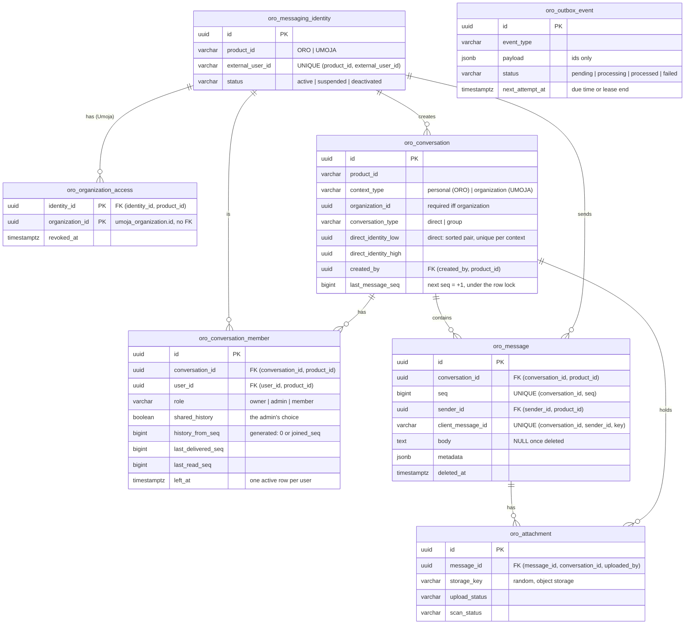

# Oro backend: the messaging database

The persistence layer of Oro Messaging, the messaging service shared by **Oro** (personal messaging: direct
messages, friends, family groups, communities) and **Umoja** (business messaging inside an organization). The two
products keep their own accounts and authentication. They share this infrastructure, and nothing in it lets one
product reach the other's identities or conversations.

Spring Boot 4.1 / Java 25, Spring Data JPA (Hibernate 7), PostgreSQL 17. The schema is plain SQL in the shared database
repository, like the rest of Asata. There is no Flyway: `ddl-auto: none`.

| What | Where |
|---|---|
| Schema (tables, triggers, roles, RLS) | [`../../1_ASATA_DATABASE/CREATE_ORO_TABLES.sql`](../../1_ASATA_DATABASE/CREATE_ORO_TABLES.sql) |
| Development data and login | [`../../1_ASATA_DATABASE/oro/INSERT.sql`](../../1_ASATA_DATABASE/oro/INSERT.sql) |
| Drop | [`../../1_ASATA_DATABASE/oro/DROP.sql`](../../1_ASATA_DATABASE/oro/DROP.sql) |
| Entities, repositories, services | `src/main/java/com/asata/org/oro/{identity,conversation,message,attachment,outbox}` |
| REST API (interfaces `*Api`, controllers) | `src/main/java/com/asata/org/oro/{mainservice,identity,conversation,message}/api` |
| Security, errors, actor resolution | `src/main/java/com/asata/org/oro/config/{security,web}` |
| Database context (role, RLS settings) | `src/main/java/com/asata/org/oro/context/DbSession.java` |
| Integration tests (Testcontainers) | `src/test/java/com/asata/org/oro` |

## Run

### Database

A new database: the scripts run on the first start of the shared database (`06-oro-create`, `07-oro-insert`).

```bash
cd ../../1_ASATA_DATABASE
docker compose up -d            # or: docker compose down -v && docker compose up -d to recreate it
```

An existing database: both scripts can be run again; they only add what is missing.

```bash
cd ../../1_ASATA_DATABASE
docker exec -i asata-postgres-1 sh -c 'psql -v ON_ERROR_STOP=1 -U "$POSTGRES_USER" -d asata' < CREATE_ORO_TABLES.sql
docker exec -i asata-postgres-1 sh -c 'psql -v ON_ERROR_STOP=1 -U "$POSTGRES_USER" -d asata' < oro/INSERT.sql   # development only
```

`oro/INSERT.sql` creates the development login `oro_service`, whose password is the placeholder `oro_service_dev`. A
deployment creates its own logins, with secrets from its vault, and never runs the seed.

### Backend with Docker

```bash
docker compose -f ../../1_ASATA_DATABASE/docker-compose.yml up -d    # the shared database, once
cd .. && docker compose up --build                                   # reads backend/.env.local
```

API: http://localhost:8082/oro, Swagger UI: http://localhost:8082/oro/doc. The container joins the shared database on
the Docker network `asataDB` (`asata-postgres:5432`) and logs in as `oro_service`. Settings go in `backend/.env.local`,
which git ignores:

| Variable | Default | Purpose |
|---|---|---|
| `UMOJA_JWT_SECRET` | none | Umoja's token secret: **the same as the Umoja backend's** (`umoja/backend/.env.local`). Unset: Umoja users cannot call Oro |
| `ORO_JWT_SECRET` | none | The secret of Oro's own account system (to come). Unset: Oro users cannot call |
| `UMOJA_INTEGRATION_KEY`, `ORO_INTEGRATION_KEY` | none | Keys of the trusted integrations (`/internal`); 32 characters at least (`openssl rand -hex 32`) |
| `ORO_PORT` | `8082` | Port on the host (8080 Mokili, 8081 Umoja) |
| `ORO_DB_USERNAME`, `ORO_DB_PASSWORD` | `oro_service`, `oro_service_dev` | Login role (`NOINHERIT`, never a superuser) and its password |
| `ORO_OUTBOX_ENABLED` | `true` | Runs the outbox worker |
| `ORO_CORS_ALLOWED_ORIGINS` | `http://localhost:4200,http://localhost:4201` | Browser origins allowed to call the API |

### Backend locally

```bash
SPRING_DATASOURCE_PASSWORD=oro_service_dev UMOJA_JWT_SECRET=... ./mvnw spring-boot:run    # localhost:5433/asata, port 8082
```

Never connect as a superuser: superusers bypass RLS. Local settings go in `src/main/resources/application-local.yml`,
which git ignores.

### Tests

```bash
./mvnw test        # Docker must be running
```

The tests start a PostgreSQL 17 container built by the real `CREATE_ORO_TABLES.sql`. The backend connects to it the
way it does in production: as a `NOINHERIT` login that takes `oro_app` or `oro_system` in each transaction. The scripts
are read from `../../1_ASATA_DATABASE`; override the location with `-Dasata.database.dir=...`. H2 is not used: it has
no RLS, no PL/pgSQL triggers and no `SKIP LOCKED`, and those are what the tests check.

| Test class | What it proves |
|---|---|
| `SchemaScriptTest` | The script runs again on an existing database; RLS is on every table, owned by `oro_owner`; `oro_app` cannot bypass RLS or read the organization accesses or the outbox; the seed loads both products and every context, and runs twice without duplicates |
| `ProductIsolationTest` | The same external user ID in both products gives two identities; an Oro identity cannot join a Umoja conversation, and the reverse; no creator or direct pair from another product; an invalid organization context is rejected; organization members need an organization access |
| `ConversationAccessTest` | Non-members and other organizations read nothing, through the services and through raw SQL; leaving, removal, revoked access and deactivation end access; members cannot rejoin on their own; the admin's choice of history is applied; concurrent creation of the same direct conversation gives one; one direct conversation per pair and organization; unread counts |
| `MessageTest` | Idempotency, including concurrent retries; consecutive sequence numbers without gaps under concurrency; a failed transaction leaves neither the message nor its event, and no gap; no sending as someone else (RLS); sequence integrity; cursor pagination; deleted content is erased for good; edits |
| `RlsContextTest` | No context means no right at all; the context never leaks to the next transaction on a pooled connection (after a commit or a rollback); product-only context; the context can only be set inside a transaction |
| `OutboxTest` | Publishing; concurrent workers never claim the same event; backoff, then `failed`, with no exception message stored; expired leases are taken over and the stale worker cannot complete; retention |
| `ApiTest` | The HTTP chain with tokens really signed by each product: wrong secret, unknown issuer, expiry; the organization header against the accesses; integration keys per product; an end-to-end Oro conversation; validation; members and history; deactivation |
| `AttachmentTest` | Metadata is visible only to those who can read the message, even with the storage key; downloads need an uploaded and clean file; the API cannot mark a file clean; a sender can attach only their own uploads; a deleted message's files are hidden and marked for purge; file names cannot be paths |

## API

All routes are under `/oro`. Errors are JSON (`status`, `message`, `requestId`; never a database detail). Every response
carries an `x-request-id` header.

### Who may call

- **Users** send `Authorization: Bearer <access token of their product>`. Each product signs its own tokens (HS256) with
  its own secret and issuer (`oro`, `umoja`). Oro reads the issuer and checks the signature with that product's
  secret, so a token from one product is never accepted as the other's. An unknown issuer, a bad signature or an expired
  token gets 401.
  - The subject is the account's ID in its product (for Umoja, `asata_user.id`). Its messaging identity is created on
    its first request: a valid product token proves the account exists.
  - Suspended or deactivated identities get 403.
- **Umoja requests** name their organization in `x-organization-id`. Umoja tokens carry no organization, so the header
  only picks one of the user's current accesses (fed by Umoja); it never grants one. A missing header gets 400, an
  organization without access gets 403. Oro requests must not send the header.
- **Trusted integrations** call `/internal` with `x-integration-key`. A key acts for its own product only, and user
  tokens are refused there.
- Clients name other users by their **user ID in their product** (`userId`), never by Oro's internal IDs.
- Anything outside the caller's reach answers 404, never 403, so an ID reveals nothing.

### Routes

| Route | What |
|---|---|
| `GET /ping`, `GET /actuator/health` | Status, public |
| `GET /doc`, `GET /doc/api` | Swagger UI, OpenAPI |
| `GET /me` | The caller: identity, product, user ID, organization |
| `GET /conversations` | The caller's active conversations in its context, latest first, with unread counts |
| `POST /conversations/direct` `{userId}` | The direct conversation with a user (created the first time; concurrent calls give one) |
| `POST /conversations/groups` `{name, description, memberUserIds}` | A group, with the caller as owner |
| `GET /conversations/{id}` | A conversation and its active members |
| `POST /conversations/{id}/members` `{userId, shareHistory}` | Owner or admin adds a member, choosing whether it sees the history |
| `DELETE /conversations/{id}/members/{userId}` | Removes a member (owner or admin), or leaves (the caller's own user ID) |
| `PUT /conversations/{id}/read`, `/delivered` `{seq}` | The caller's positions (only move forward) |
| `GET /conversations/{id}/messages?before=&size=` | Newest first, then `before=nextBeforeSeq`; `?after=seq` catches up, oldest first |
| `POST /conversations/{id}/messages` `{clientMessageId, type, body, metadata, attachmentIds}` | 201 stored; 200 when a retry with the same `clientMessageId` returns the stored message |
| `PUT /messages/{id}` `{body}`, `DELETE /messages/{id}` | The sender edits, or deletes (the content is erased) |
| `PUT /internal/identities/{userId}` | Integration: provisions an identity |
| `POST /internal/identities/{userId}/suspend`, `/reactivate`, `/deactivate` | Integration: changes an identity's status |
| `PUT`, `DELETE /internal/organizations/{organizationId}/members/{userId}` | Umoja integration: grants or revokes an organization access |

```bash
# Umoja: Jordan's conversations in Acme (a token from the Umoja backend's login)
curl -H "Authorization: Bearer $TOKEN" -H "x-organization-id: <organization id>" http://localhost:8082/oro/conversations
# Umoja's integration: Amara joins Acme's conversations
curl -X PUT -H "x-integration-key: $UMOJA_INTEGRATION_KEY" http://localhost:8082/oro/internal/organizations/<org>/members/<asata user id>
```

## Schema



### Identities

Each product account maps to one `oro_messaging_identity`, unique on `(product_id, external_user_id)`. For Oro the
external ID is its account ID; for Umoja it is `asata_user.id`. The table holds no email, phone, username or
credential, and identities from different products are never linked: the same external ID in both products is two
identities. External IDs cannot contain `@`, so an email cannot be used as one.

Provisioning (`IdentityService.provision`) and status changes are for the products' trusted integrations only (role
`oro_system`). Provisioning is idempotent: `INSERT … ON CONFLICT DO NOTHING`, then a read. A suspended identity keeps
its memberships but reads and sends nothing. A deactivated identity is final: it leaves all its conversations and
loses its organization accesses, in the same transaction (trigger).

### Product isolation and context

Every table carries `product_id`, and every reference is a composite foreign key `(x_id, product_id)` →
`(id, product_id)`. This covers creators, direct pairs, members, senders and attachments, so a row cannot mix
products whatever the code does.

`ck_oro_conversation_context` allows exactly two combinations:
- Oro → `personal`, no organization
- Umoja → `organization`, with `organization_id`

Opening other combinations later means relaxing this one constraint. Members and messages do not repeat the
organization; they inherit it from their conversation, so they cannot disagree with it.

### Umoja organization authorization

The organization memberships belong to Umoja. Oro never reads Umoja's database, and no foreign key can check data owned
by another system. Instead:

1. **`oro_organization_access`** is Oro's copy of who may take part in an organization's conversations. Only
   `oro_system` writes it, fed by the Umoja integration: a push on each change (grant, revoke), plus a periodic
   reconciliation that compares the full list.
2. **Triggers** require a current access for the creator of an organization conversation and for each new member.
   Revoking (or deleting) an access ends that identity's memberships in the organization's conversations, in the same
   transaction.
3. **On each request**, the API reads the organization from the `x-organization-id` header (Umoja tokens carry none)
   and accepts it only if the identity has a current access to it (403 otherwise). Then it builds
   `Actor.umoja(identity, organization)` (`ActorResolver`). `ConversationAccess` refuses any conversation outside that
   organization with `NotFound`, the same answer as for one that doesn't exist.

The access list is only as fresh as the feed. An access revoked in Umoja keeps working in Oro until the push arrives (or
the next reconciliation runs), so the push should happen in the same operation that removes the membership in Umoja. A
short-lived organization claim in the Umoja tokens would close that window.

### Direct conversations

A direct conversation stores its pair sorted by PostgreSQL (`direct_identity_low < direct_identity_high`, compared as
`uuid`; `java.util.UUID` orders differently, so the API sorts with `LEAST`/`GREATEST` in SQL). Two partial unique
indexes, one for personal and one per organization, make the pair one conversation per context. Personal and
organization conversations between the same people stay separate.

`ConversationService.openDirect` runs `INSERT … ON CONFLICT DO NOTHING`, then reads the row, then adds both
memberships (`ON CONFLICT DO NOTHING` on the active-membership index). Concurrent calls, in either order, all wait on
the unique index for the first insert and then find its row. There is no read-then-insert race. Only the pair may
join, and a direct conversation cannot be left (only revocation or deactivation ends it).

### Memberships and history

A membership is one period, `joined_at` to `left_at`, recorded with a reason: `left`, `removed`, `access_revoked` or
`deactivated`. Rejoining adds a new row; the partial unique index allows one active row per user. An ended row never
changes again.

Access policy:
- Only an active member can read a conversation. Leaving or removal ends access to everything, history included.
- Ended members cannot add themselves back; an admin must re-add them.
- The admin who adds a member chooses `shared_history`:
  - true: the member reads the whole history
  - false (the default, privacy first): only messages after `joined_seq`
- `history_from_seq` is a generated column (`0` or `joined_seq`), so it can't be forged, and both RLS and the queries
  use it.
- The trigger sets `joined_seq` from the conversation while holding its row lock, so a member always joins between two
  messages, never during one.

### Messages, ordering and idempotency

Each conversation keeps `last_message_seq`. A send moves it forward by exactly one under the row lock (the trigger
refuses anything else), and the message takes that number (the trigger checks `seq <= last_message_seq`, and
`uq_oro_message_seq` stops reuse). This gives a strict order with no gaps, a stable cursor, and unread counts without
counting rows.

The price is that sends in one conversation run one at a time: a few milliseconds each. That limits a single
conversation to roughly a few hundred messages per second, far beyond normal chat. A huge broadcast channel would need a
different design (e.g. `(created_at, id)` ordering without the lock).

**Sending (`MessageService.send`) is one transaction:**
1. Authenticate (API) and set the context (`DbSession.enterUser`: role `oro_app` plus the RLS settings).
2. Lock the conversation (`SELECT … FOR NO KEY UPDATE`), within the actor's product and organization.
3. Check active membership (service, and again in the trigger).
4. Look up the idempotency key `(conversation_id, sender_id, client_message_id)`. A retry returns the stored message
   (`duplicate = true`). A concurrent retry waits on the lock and then finds it; the unique constraint backs this up.
5. Take the next `seq`, insert the message, attach the sender's uploads, and move the sender's read position.
6. Insert the outbox event `message.created`.
7. Commit. Any failure rolls everything back, including the sequence number, so no gap appears.
8. A worker publishes the event later, with retries.

A committed message is **stored**, not delivered. **Delivered** (`last_delivered_seq`) means a recipient's device
acknowledged it; **read** (`last_read_seq`) means the user saw it. Both positions only move forward and are clamped to
the last message by the trigger.

**Deletion** keeps the row as a tombstone so the message keeps its place in the order. The trigger erases the content
(`body` NULL, `metadata` `{}`), a check constraint guarantees it, and a deleted message cannot be undeleted or edited.
Its attachments are marked `deleted_at` for purging. Edits set `edited_at` (in the database); no edit history is kept.
`metadata` is optional extensible data (mentions, link previews), at most 8 KB, and never holds authorization data.

### Read state: positions, not receipts

Each member stores a read position (`last_read_seq`) and a delivered position (`last_delivered_seq`). This is one
update per conversation read, instead of one row per message per recipient. Unread count =
`conversation.last_message_seq − member.last_read_seq`; `ConversationService.list` computes it for every conversation
in one query.

Switch to per-message receipts (a `message_receipt(message_id, user_id, delivered_at, read_at)` table, partitioned)
only if the product needs:
- read-by-whom lists in groups ("seen by 12"), or
- read state that is not in order (marking a single older message as read).

Even then, keep the positions for the counts.

### Attachments

Files live in an object storage; PostgreSQL holds only their metadata. The flow:

1. **Register**: the API creates the row and returns a signed upload URL. The storage key is random and never built
   from the file name.
2. **Upload**: the client uploads directly to the storage.
3. **Check**: `oro_system` checks the real size and checksum (`markUploaded`), then records the malware scan
   (`recordScan`).
4. **Attach**: the sender attaches the file when sending. A composite foreign key ties it to a message of the same
   conversation and sender; a rejected or infected file cannot be attached.
5. **Download**: only an active member who can read the message, only an uploaded and clean file, through a
   short-lived signed URL.

`oro_app` may change only `message_id`, so the API can never mark a file clean, and the storage key gives access to
nothing.

### Outbox

`oro_outbox_event` rows are written in the same transaction as their change: an event exists if and only if the change
was committed. Payloads hold only IDs, sequence numbers and codes (`OutboxWriter` refuses anything else). Consumers
read the content through an authorized path and must be idempotent on the event ID, because delivery is at least once.

`OutboxWorker` (role `oro_system`):
- **Claim**: `FOR UPDATE SKIP LOCKED` on due events, so two workers never take the same one. The event becomes
  `processing` with a lease: `next_attempt_at = now + lease` (30 s).
- **Publish**: outside any transaction. If a worker dies, its lease expires and another worker takes the event again
  (it is published again, hence idempotent consumers). A stale worker can no longer complete or fail an event it lost.
- **Retry**: `pending` again after `base × 2^(attempt−1)`, capped at 1 h, with ±20 % jitter. After `max-attempts`
  (10) the event becomes `failed`.
- **Errors**: only a code is stored (the exception class), plus a message only from an `OutboxPublishException`, which
  carries a safe one.
- **Retention**: processed events are deleted after 7 days (`purgeProcessed`, every hour).
- **Configuration**: `oro.outbox.*`.

`OutboxPoller` runs the worker every second on each instance. `LoggingOutboxEventHandler` stands in for the delivery
gateway: replace it with an `OutboxEventHandler` bean.

### Row-level security and roles

| Role | Login | RLS | Rights |
|---|---|---|---|
| `oro_owner` | no | bypassed (owner, RLS not forced) | owns the tables and the `SECURITY DEFINER` functions; never used to connect |
| `oro_app` | no | **enforced** | the API: reads its product's rows and the current identity's; may update only a few columns (column grants); no access to `oro_organization_access`; insert-only on the outbox |
| `oro_system` | no | own `USING (true)` policies | integrations and workers: identity provisioning, organization access, outbox, attachment checks, limited by grants |
| `oro_service` (dev) | yes, `NOINHERIT` | n/a | member of both roles, with no rights of its own |
| superusers | yes | **bypassed** | scripts and seeds only, never the backend |

Each transaction starts with `DbSession.enterUser(actor)`, which runs `SET LOCAL ROLE oro_app` and
`set_config('oro.product_id' / 'oro.identity_id', …, true)`.

- **Transaction-local**: both settings reset at commit or rollback, so a pooled connection carries nothing over to the
  next transaction (tested).
- **Fail closed**: a transaction that forgets to set a context gets `permission denied`, because the login has no
  rights of its own. A missing setting matches no row.
- **What the policies allow** (for `oro_app`):
  - identities of the same product;
  - conversations the identity is an active member of, plus direct conversations it belongs to (to find the existing
    one; their messages stay closed);
  - messages after its `history_from_seq`;
  - attachments of readable messages;
  - inserts only with `sender_id` / `created_by` / `uploaded_by` equal to the current identity.
- **Membership checks** use `SECURITY DEFINER` functions (`oro_member_history_from`, `oro_can_add_member`), because a
  policy cannot read its own table without recursion.

RLS is defense in depth. The services check product, organization, membership and role first, and answer `NotFound`
for anything not visible.

A deployment that separates the API from the workers should give the API's login only `oro_app`. With one shared login
(`oro_service`), SQL injection in the API could `SET ROLE oro_system`.

### Indexes and query patterns

| Query | Index |
|---|---|
| Resolve `(product, external user id)` → identity | `uq_oro_messaging_identity_external` |
| Active conversations of a user | `idx_oro_conversation_member_user (user_id) INCLUDE (conversation_id) WHERE left_at IS NULL`, then the conversations by primary key |
| Membership check, members of a conversation | `uq_oro_conversation_member_active (conversation_id, user_id) WHERE left_at IS NULL` |
| Newest messages, older pages (`seq < cursor`), catch-up (`seq > cursor`) | `uq_oro_message_seq (conversation_id, seq)`, scanned in either direction, never `OFFSET` |
| Idempotency lookup | `uq_oro_message_client (conversation_id, sender_id, client_message_id)` |
| Unread counts | none needed: `last_message_seq − last_read_seq` |
| Attachments of a message | `idx_oro_attachment_message (message_id) WHERE message_id IS NOT NULL` |
| Due outbox events, purge | `idx_oro_outbox_event_due (next_attempt_at) WHERE status IN ('pending', 'processing')`, `idx_oro_outbox_event_processed` |
| Direct conversation of a pair | `uq_oro_conversation_direct_personal` / `_organization` |

No other index: each one would slow writes without serving a query.

### Partitioning

None yet. Consider partitioning `oro_message` by hash of `conversation_id` (16–64 partitions; the per-conversation
queries stay single-partition) when one of these holds:
- the table passes roughly 200–500 M rows or 100–200 GB;
- autovacuum on it can no longer keep up (dead tuples, freeze age);
- its index no longer fits in memory and page reads start hitting the disk (p99 above ~50 ms);
- retention needs to drop old data in bulk (then range by time instead).

Watch `pg_stat_user_tables` (dead tuples, vacuum times), the index sizes, and the p99 of the page and send queries.

## Operations

- **Monitoring**: alert on any `failed` outbox event, and on the age of the oldest `pending` event (the outbox lag).
  Watch lock waits on `oro_conversation` (sends contending in one conversation).
- **Replay**: after a fix, put a failed event back with
  `UPDATE oro_outbox_event SET status = 'pending', next_attempt_at = now(), attempt_count = 0 WHERE id = …`, as
  `oro_system`.
- **Purges**: processed outbox events (automatic); attachments with `deleted_at` (delete the object, then the row, as
  `oro_system`); uploads never attached after 24 h (same). The last two jobs are not written yet.
- **Reconciliation**: the Umoja integration should compare `oro_organization_access` with Umoja's memberships
  periodically and revoke what no longer exists.
- **Backups**: they contain message content; encrypt them and keep them only as long as the retention policy allows.

## Limitations

- **Basic REST API only.** There is no WebSocket or push delivery: clients poll, or catch up with `?after=`. Oro has no
  account system of its own yet to issue its users' tokens. Integration keys are static, with no rotation; mTLS or
  signed requests would be stronger. The attachment endpoints (upload URL, download URL) are not exposed.
- **Umoja doesn't call `/internal` yet.** Its organization memberships must be pushed there for Umoja users to message;
  until then, grant them by hand with the integration key.
- **No real delivery or storage.** No delivery gateway or push notifications (`LoggingOutboxEventHandler`), no object
  storage client (no signed URLs), no malware scanner; only their database side exists.
- **Feeds and jobs not written.** The Umoja access feed and its reconciliation, and the purge jobs for attachments,
  remain to be written.
- **Moderation and editing.** No moderation deletion by admins (only senders change their messages), no edit history,
  no message reactions or threads.
- **Send failure edge case.** A unique-key violation on a send (only reachable outside the locking path) surfaces as an
  error rather than as the stored message.
